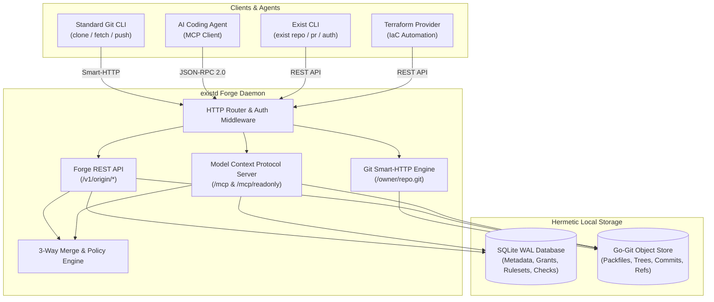

# exist.io

<p align="center">
  <strong>A self-hosted Git forge for people and coding agents.</strong>
</p>

<p align="center">
  <a href="https://ravaniroshan.github.io/exist.io/"></a>
  
  
  
  
  
</p>

---

Product documentation: **[exist.io docs](https://ravaniroshan.github.io/exist.io/)**

exist.io is an open-source, self-hosted Git forge built from the ground up for both software engineering teams and autonomous AI coding agents. It pairs standard Git transport with deep agent integrations, fine-grained access policies, and automated merge verification—all packaged in a single, hermetic Go binary with zero external cloud dependencies.

> [!NOTE]
> exist.io is wire-compatible with Origin forge interfaces, allowing existing tools, clients, and agents to interact with a self-hosted instance without code modifications.

---

## Highlights

- **Native Git Smart-HTTP Engine:** Standard `git clone`, `git fetch`, and `git push` over HTTP with token and credential-helper authentication.
- **First-Class Agent Support (MCP):** Embedded Model Context Protocol server exposing 34 specialized tools for AI coding agents over JSON-RPC 2.0 at `/mcp` (read-write) and `/mcp/readonly` (sandboxed read-only).
- **Comprehensive Forge API:** Complete REST API covering namespaces, repositories, branches, commits, trees, blobs, diffs, pull requests, reviews, line comments, reactions, status checks, and rulesets.
- **Pull Request Collaboration & Merge Engine:** Native 3-way merge and squash pipelines with conflict detection, required review gates, check runs enforcement, and auto-merge queues.
- **Enterprise Policy & Security:** Fine-grained repository grants, branch and tag rulesets, bypass actor hierarchies, inbound IP allowlists, and SSH Certificate Authority signing.
- **GitHub Mirroring & Webhooks:** Live repository synchronization with upstream GitHub, signed Ed25519 webhook dispatch, and delivery retry queues.
- **CLI Companion:** Command-line tool (`exist`) for developer workflows, terminal management, and automation.
- **Zero CGO, Single Binary:** Built with pure Go (`go-git/v6` and `modernc.org/sqlite` with WAL mode and foreign keys enabled), producing a standalone static binary (`existd`).

---

## Architecture



---

## Quickstart

### Prerequisites

- **Go:** 1.22 or higher
- **Git:** 2.30 or higher

### Build

Compile the daemon (`existd`) and CLI (`exist`):

```bash
# Build the forge server daemon
go build -o bin/existd ./cmd/existd

# Build the command-line interface
go build -o bin/exist ./cmd/exist
```

### Bootstrap First Administrator

Initialize your local SQLite database and issue the root administrative token:

```bash
./bin/existd bootstrap \
  --email admin@example.com \
  --namespace acme \
  --data-dir ./data
```

This command provisions the database schema, creates the `acme` namespace and initial admin user, and outputs your root API token.

### Start the Server

```bash
# Run exist.io daemon on port 8080
./bin/existd
```

> [!TIP]
> By default, `existd` binds to `0.0.0.0:8080` with data stored in `./data`. Customize this using flags or environment variables.

### Service Endpoints

| Endpoint | Protocol | Description |
| :--- | :--- | :--- |
| `http://localhost:8080/{owner}/{repo}.git` | Git Smart-HTTP | Clone, fetch, and push endpoint |
| `http://localhost:8080/v1/origin` | REST / JSON | Full forge REST API |
| `http://localhost:8080/mcp` | MCP (JSON-RPC 2.0) | Read-write Model Context Protocol endpoint |
| `http://localhost:8080/mcp/readonly` | MCP (JSON-RPC 2.0) | Sandboxed read-only Model Context Protocol endpoint |
| `http://localhost:8080/v1/origin/openapi.yaml` | HTTP / YAML | OpenAPI 3.1 specification |
| `http://localhost:8080/healthz` | HTTP | Health and liveness probe |

---

## Using the CLI

Configure the `exist` CLI to communicate with your instance:

```bash
export EXIST_ENDPOINT="http://localhost:8080/v1/origin"
export EXIST_TOKEN="<your-admin-token>"
```

### Common Commands

```bash
# Create a new repository
./bin/exist repo create acme/my-service

# Clone over Git Smart-HTTP
git clone http://localhost:8080/acme/my-service.git

# Create a pull request
./bin/exist pr create \
  -R acme/my-service \
  --title "Add authentication middleware" \
  --head feature/auth \
  --base main

# List pull requests
./bin/exist pr list -R acme/my-service

# Call any REST endpoint directly via CLI
./bin/exist api repos/acme/my-service/pulls
```

---

## AI Agent Integration (MCP)

`exist.io` natively speaks the [Model Context Protocol (MCP)](https://modelcontextprotocol.io), allowing AI coding agents to interact directly with the forge.

### Connecting an Agent

Add the `exist.io` MCP server to your agent's configuration (e.g., Claude Desktop, Cursor, Cline, or custom agent):

```json
{
  "mcpServers": {
    "exist-io": {
      "url": "http://localhost:8080/mcp",
      "headers": {
        "Authorization": "Bearer <your-token>"
      }
    }
  }
}
```

For untrusted or inspect-only agents, connect to `http://localhost:8080/mcp/readonly` to enforce read-only execution at the protocol layer.

### Available MCP Tools (Sample)

| Tool Name | Scope | Description |
| :--- | :--- | :--- |
| `repo_tree` | Read | Recursively inspect file trees at any commit or ref |
| `file_read` | Read | Read blob contents and metadata |
| `diff_compare` | Read | Calculate two-way and three-way diffs between refs |
| `pull_request_create` | Write | Open a pull request with base and head branches |
| `pull_request_merge` | Write | Execute a 3-way or squash merge through policy gates |
| `thread_comment` | Write | Create inline code review threads or general comments |
| `status_check_report` | Write | Report check run results (success, failure, in-progress) |

List all 34 tools programmatically:

```bash
curl -s -X POST http://localhost:8080/mcp \
  -H "Content-Type: application/json" \
  -H "Authorization: Bearer <your-token>" \
  -d '{"jsonrpc":"2.0","id":1,"method":"tools/list"}'
```

---

## Configuration

`existd` is configured through command-line flags or environment variables:

| Environment Variable | CLI Flag | Default | Description |
| :--- | :--- | :--- | :--- |
| `EXISTD_ADDR` | `--addr` | `:8080` | TCP network address to bind to |
| `EXISTD_DATA_DIR` | `--data-dir` | `./data` | Directory for SQLite database and Git object repositories |
| `EXISTD_BASE_URL` | `--base-url` | `http://localhost:8080` | Canonical public URL used in webhook payloads and links |
| `EXISTD_LOG_LEVEL` | `--log-level` | `info` | Logging verbosity (`debug`, `info`, `warn`, `error`) |

---

## Verification & Testing

The entire forge is tested with contract, integration, and unit tests:

```bash
# Run all unit and integration test suites
go test -count=1 ./...

# Run static analysis
go vet ./...

# Validate and build the Blume documentation site
npm --prefix site run validate
npm --prefix site run build
```
