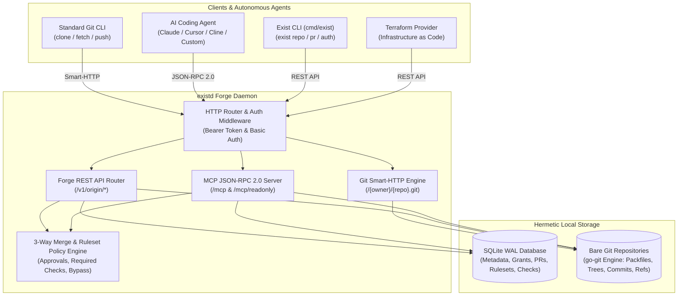

<div align="center">


<p align="center">
  <strong>An open-source, self-hosted Git forge built for software engineering teams and autonomous AI coding agents.</strong>
</p>

<p align="center">
  <a href="https://ravaniroshan.github.io/exist.io/"></a>
  <a href="ROADMAP.md"></a>
  
  
  
  
  
</p>

[**Product Documentation**](https://ravaniroshan.github.io/exist.io/) &nbsp;&bull;&nbsp; [**Product Roadmap**](ROADMAP.md) &nbsp;&bull;&nbsp; [**Architecture**](https://ravaniroshan.github.io/exist.io/architecture) &nbsp;&bull;&nbsp; [**Getting Started**](https://ravaniroshan.github.io/exist.io/getting-started)

</div>

---

**exist.io** gives engineering teams and agent developers a self-hosted Git forge that runs entirely on infrastructure you control. It bridges human collaboration and AI automation by providing full Git Smart-HTTP transport, complete REST API coverage, native 3-way merge policies, and an embedded Model Context Protocol (MCP) server exposing 34 specialized tools directly to AI coding agents.

> [!NOTE]
> exist.io provides full wire compatibility with Origin forge interfaces, allowing existing agent tools, CLI commands, and Terraform providers to interact seamlessly with a self-hosted instance without code modifications.

---

## ⚡ Core Capabilities

<table>
  <tr>
    <td width="50%">
      <h3>🌐 Git Smart-HTTP Transport</h3>
      <p>Native HTTP Git engine supporting standard <code>git clone</code>, <code>git fetch</code>, and <code>git push</code> with token authentication and repository permission checks.</p>
    </td>
    <td width="50%">
      <h3>🤖 First-Class Agent Support (MCP)</h3>
      <p>Embedded Model Context Protocol server exposing 34 tools over JSON-RPC 2.0 at <code>/mcp</code> and a sandboxed read-only endpoint at <code>/mcp/readonly</code>.</p>
    </td>
  </tr>
  <tr>
    <td width="50%">
      <h3>🔀 Pull Requests & 3-Way Merge</h3>
      <p>Native 3-way merge engine, squash merging, conflict detection, review approval gates, required status checks, and auto-merge queues.</p>
    </td>
    <td width="50%">
      <h3>🛡️ Enterprise Policy & Rulesets</h3>
      <p>Branch and tag protection rulesets, bypass actor hierarchies, inbound IP allowlists (CIDR filtering), and SSH Certificate Authority management.</p>
    </td>
  </tr>
  <tr>
    <td width="50%">
      <h3>📦 100% Wire API Coverage</h3>
      <p>Complete implementation of 119 REST operations spanning repos, branches, commits, trees, diffs, reviews, reactions, labels, and webhooks.</p>
    </td>
    <td width="50%">
      <h3>⚡ Zero CGO, Single Static Binary</h3>
      <p>Built with pure Go (<code>go-git/v6</code> and <code>modernc.org/sqlite</code> in WAL mode), compiling into a self-contained binary (<code>existd</code>) with zero external runtime dependencies.</p>
    </td>
  </tr>
</table>

---

## 🏗️ System Architecture



---

## 🚀 Quickstart

### 1. Build from Source

Compile the server daemon (`existd`) and CLI (`exist`):

```bash
# Build the forge server daemon
go build -o bin/existd ./cmd/existd

# Build the companion CLI
go build -o bin/exist ./cmd/exist
```

### 2. Bootstrap Your Administrator

Initialize your local SQLite database and issue the root administrative token:

```bash
./bin/existd bootstrap \
  --email admin@example.com \
  --namespace acme \
  --data-dir ./data
```

This creates the `./data/meta.db` database, provisions the initial admin namespace (`acme`), and prints your root administrative API token.

### 3. Start the Server

```bash
# Start existd on port 8080
./bin/existd
```

> [!TIP]
> The server listens on `0.0.0.0:8080` by default. Customize via flags (e.g. `--addr :9000 --data-dir /var/lib/exist`) or environment variables.

### Service Endpoints

| Endpoint | Protocol | Description |
| :--- | :--- | :--- |
| `http://localhost:8080/{owner}/{repo}.git` | Git Smart-HTTP | Clone, fetch, and push endpoint |
| `http://localhost:8080/v1/origin` | REST / JSON | Full forge REST API (119 operations) |
| `http://localhost:8080/mcp` | MCP (JSON-RPC) | Read-write Model Context Protocol endpoint |
| `http://localhost:8080/mcp/readonly` | MCP (JSON-RPC) | Sandboxed read-only Model Context Protocol endpoint |
| `http://localhost:8080/v1/origin/openapi.yaml` | HTTP / YAML | Live OpenAPI 3.1 specification |
| `http://localhost:8080/healthz` | HTTP | Health and liveness probe |

---

## 💻 CLI & Git Workflow

Configure the `exist` CLI with your administrator credentials:

```bash
export EXIST_ENDPOINT="http://localhost:8080/v1/origin"
export EXIST_TOKEN="<your-admin-token>"
```

### Create a Repository & Push Code

```bash
# 1. Create repository via CLI
./bin/exist repo create acme/my-service

# 2. Clone repository over Git Smart-HTTP
git clone http://localhost:8080/acme/my-service.git
cd my-service

# 3. Commit and push
echo "# My Service" > README.md
git add README.md
git commit -m "feat: initial commit"
git push -u origin main
```

### Pull Request & Review Flow

```bash
# 1. Create a feature branch
git checkout -b feature/auth
echo "package auth" > auth.go
git add auth.go && git commit -m "feat: add auth package"
git push origin feature/auth

# 2. Open pull request via CLI
./bin/exist pr create \
  -R acme/my-service \
  --title "Implement authentication layer" \
  --head feature/auth \
  --base main

# 3. List pull requests
./bin/exist pr list -R acme/my-service
```

---

## 🤖 Connecting AI Coding Agents (MCP)

`exist.io` natively speaks the [Model Context Protocol (MCP)](https://modelcontextprotocol.io), allowing AI coding agents to interact directly with the forge over JSON-RPC 2.0.

### Client Configuration

Add `exist.io` to your agent configuration file (e.g., Claude Desktop, Cursor, Cline):

```json
{
  "mcpServers": {
    "exist-io": {
      "url": "http://localhost:8080/mcp",
      "headers": {
        "Authorization": "Bearer <your-token>"
      }
    }
  }
}
```

> [!TIP]
> **Read-Only Sandbox:** For unvetted agents, set the URL to `http://localhost:8080/mcp/readonly`. Any mutation attempt (`pull_request_create`, `thread_comment`, `pull_request_merge`) is automatically rejected at the protocol layer.

### Key MCP Tools (34 Total)

| Tool Name | Type | Description |
| :--- | :--- | :--- |
| `repo_tree` | Read | Recursively inspect file trees at any commit or ref |
| `file_read` | Read | Read blob contents, encoding, and metadata |
| `diff_compare` | Read | Calculate two-way and three-way diffs between branches or commits |
| `pull_request_create` | Write | Open a pull request with base and head branches |
| `pull_request_merge` | Write | Execute a 3-way or squash merge through policy gates |
| `thread_comment` | Write | Post inline code review comments or reply to review threads |
| `status_check_report` | Write | Report check run results (success, failure, in-progress) |

---

## ⚙️ Configuration

| Environment Variable | CLI Flag | Default | Description |
| :--- | :--- | :--- | :--- |
| `EXIST_LISTEN_ADDR` | `--addr` | `127.0.0.1:8080` | TCP network address to bind the HTTP daemon |
| `EXIST_DATA_DIR` | `--data-dir` | `./data` | Directory for SQLite database and Git bare repositories |
| `EXIST_PUBLIC_URL` | `--public-url` | `http://127.0.0.1:8080` | Canonical public URL used in webhooks and links |
| `EXIST_GIT_URL` | `--git-url` | `127.0.0.1:8080` | Public host used in clone URLs |

---

## 🧪 Verification & Testing

Every package is covered by automated unit, contract, and integration tests:

```bash
# Run all Go tests
go test -count=1 ./...

# Run static analysis
go vet ./...

# Validate and build documentation site
npm --prefix site run validate
npm --prefix site run build
```

---

## 🗺️ Product Roadmap

See [**ROADMAP.md**](ROADMAP.md) for the complete evolutionary roadmap, including:
- **Phase 2 (v0.2):** Visual Web Dashboard & Browser Code Review UI
- **Phase 3 (v0.3):** Native SSH Git Server & Git LFS Storage
- **Phase 4 (v0.4):** Autonomous Agent Execution Sandbox & Task Dispatcher
- **Phase 5 (v0.5):** High-Availability Clustering & Cross-Forge Federation
