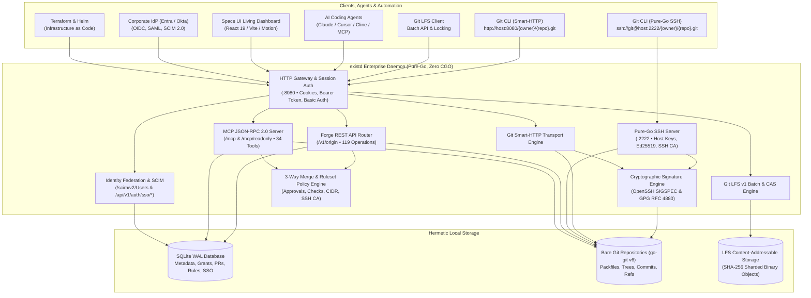

<div align="center">


<p align="center">
  <strong>An open-source, enterprise-ready, self-hosted Git forge built for software engineering teams and autonomous AI coding agents.</strong>
</p>

<p align="center">
  <a href="https://ravaniroshan.github.io/exist.io/"></a>
  <a href="ROADMAP.md"></a>
  
  
  
  
  
  
  
  
  
</p>

[**Product Documentation**](https://ravaniroshan.github.io/exist.io/) &nbsp;&bull;&nbsp; [**Roadmap**](ROADMAP.md) &nbsp;&bull;&nbsp; [**Architecture**](https://ravaniroshan.github.io/exist.io/architecture) &nbsp;&bull;&nbsp; [**Getting Started**](https://ravaniroshan.github.io/exist.io/getting-started) &nbsp;&bull;&nbsp; [**Terraform Provider**](deploy/terraform-provider-exist) &nbsp;&bull;&nbsp; [**Helm Chart**](deploy/helm/exist-enterprise)

</div>

---

**exist.io** gives engineering teams and agent developers a standalone, enterprise-ready Git forge that runs entirely on infrastructure you control. It bridges human collaboration and AI automation with dual Git transports (Smart-HTTP + embedded pure-Go SSH on port 2222), Git Large File Storage (LFS) v1 with file locking, real-time OpenSSH & GPG commit signature verification, enterprise identity federation (OIDC, SAML 2.0, and RFC 7644 SCIM 2.0 user sync), official Infrastructure as Code (Terraform / OpenTofu and Kubernetes Helm), autonomous AI agent PR code reviews, ephemeral capability leases, pure-Go AST symbol search, and a native Model Context Protocol (MCP) server exposing 35 specialized tools directly to AI coding agents.

> [!NOTE]
> exist.io provides full wire compatibility with Origin forge interfaces while remaining 100% open-source and self-hosted with zero external proprietary dependencies.

---

## ⚡ Core Capabilities

<table>
  <tr>
    <td width="50%">
      <h3>🌐 Dual Git Transports (HTTP & SSH :2222)</h3>
      <p>Native HTTP Smart-HTTP engine and embedded, zero-cgo pure-Go SSH server on port <code>2222</code> supporting user public keys and organization-wide SSH Certificate Authorities.</p>
    </td>
    <td width="50%">
      <h3>📦 Git LFS v1 CAS & Object Locking</h3>
      <p>RFC-compliant Git Large File Storage engine with SHA-256 Content-Addressable Storage (CAS), streaming chunked upload/download, and binary file locking protocol.</p>
    </td>
  </tr>
  <tr>
    <td width="50%">
      <h3>🛡️ Cryptographic Commit Verification</h3>
      <p>Native parsing of <strong>OpenSSH SIGSPEC</strong> binary blocks and <strong>GPG (RFC 4880)</strong> signatures. Real-time audit popover with key fingerprint and committer identity validation.</p>
    </td>
    <td width="50%">
      <h3>🔑 Enterprise SSO & SCIM 2.0 Sync</h3>
      <p>Enterprise Single Sign-On via <strong>OpenID Connect (OIDC)</strong> and <strong>SAML 2.0</strong>, paired with automated employee provisioning and offboarding via <strong>RFC 7643 / RFC 7644 SCIM 2.0</strong>.</p>
    </td>
  </tr>
  <tr>
    <td width="50%">
      <h3>🤖 First-Class Agent Support (MCP & Leases)</h3>
      <p>Embedded Model Context Protocol server exposing 35 JSON-RPC tools at <code>/mcp</code> (including AST symbol search), cryptographic capability lease tokens, and automated PR code reviews for Claude Code, Cursor, and Cline.</p>
    </td>
    <td width="50%">
      <h3>🏗️ Infrastructure as Code (Terraform & Helm)</h3>
      <p>Official Terraform / OpenTofu provider for automated repo & policy management, and production Kubernetes Helm chart with Prometheus ServiceMonitor and non-root security contexts.</p>
    </td>
  </tr>
  <tr>
    <td width="50%">
      <h3>🔀 Pull Requests & 3-Way Merge Engine</h3>
      <p>Deterministic 3-way merge engine, squash merging, conflict detection, review approval gates, required check suites, and automated merge queues.</p>
    </td>
    <td width="50%">
      <h3>💎 GitHub Primer UI & Developer Parity</h3>
      <p>Precision-engineered GitHub Primer design system with 6px squircle radius, custom OKLCH color token architecture, 52-week contribution heatmaps, User Profile credentials (SSH keys / PATs), Issue tracker with autonomous agent triage, and cryptographically verified Releases.</p>
    </td>
  </tr>
</table>

---

## 🏗️ System Architecture



---

## 🚀 Quickstart

### 1. Build from Source

Compile the server daemon (`existd`) and CLI (`exist`):

```bash
# Build the forge server daemon (pure Go, zero cgo)
go build -o bin/existd ./cmd/existd

# Build the companion CLI
go build -o bin/exist ./cmd/exist
```

### 2. Bootstrap Your Administrator

Initialize your local SQLite database, provision the initial organization namespace, and issue the root administrative token:

```bash
./bin/existd bootstrap \
  --email admin@corp.exist.io \
  --namespace acme \
  --data-dir ./data
```

### 3. Start the Server

```bash
# Start existd on HTTP :8080 and SSH :2222
./bin/existd
```

### 4. Docker Compose Enterprise Deployment

Alternatively, deploy the complete enterprise stack with hot S3 replication and Prometheus monitoring in one command:

```bash
docker compose -f docker-compose.enterprise.yml up -d
```

### Service Endpoints

| Endpoint | Protocol | Description |
| :--- | :--- | :--- |
| `http://localhost:3000` | Web UI | Space UI living developer dashboard & admin console |
| `ssh://git@localhost:2222/{owner}/{repo}.git` | Pure-Go SSH | Embedded SSH clone, fetch, and push |
| `http://localhost:8080/{owner}/{repo}.git` | Git Smart-HTTP | HTTP clone, fetch, and push |
| `http://localhost:8080/{owner}/{repo}.git/info/lfs` | Git LFS | Large File Storage v1 Batch and Object API |
| `http://localhost:8080/v1/origin` | REST / JSON | Full forge REST API (119 operations) |
| `http://localhost:8080/scim/v2/Users` | SCIM 2.0 | RFC 7644 automated user provisioning endpoint |
| `http://localhost:8080/api/v1/auth/sso/*` | OIDC / SAML | Enterprise SSO login and metadata endpoints |
| `http://localhost:8080/mcp` | MCP (JSON-RPC) | Read-write Model Context Protocol endpoint (34 tools) |
| `http://localhost:8080/mcp/readonly` | MCP (JSON-RPC) | Sandboxed read-only Model Context Protocol endpoint |
| `http://localhost:8080/metrics` | Prometheus | Metrics exposition for Grafana and Kubernetes |
| `http://localhost:8080/healthz` | HTTP | Kubernetes liveness and readiness probe |

---

## 💻 Git & Enterprise Workflows

### Clone and Push via Pure-Go SSH (:2222)

```bash
# 1. Enroll your public key in the Web UI or via API
# 2. Clone via SSH
git clone ssh://git@localhost:2222/acme/my-service.git
cd my-service

# 3. Sign commits with SSH and push
git config user.signingkey ~/.ssh/id_ed25519.pub
git config gpg.format ssh
git config commit.gpgsign true

echo "Hello, exist.io" > README.md
git add README.md
git commit -m "feat: initial signed commit"
git push -u origin main
```

### Track Large Files with Git LFS

```bash
# Track design files and machine learning models
git lfs track "*.onnx" "*.tar.gz"
git add .gitattributes
git commit -m "chore: track models with Git LFS"

# Push LFS binary objects to Content-Addressable Storage
git add models/checkpoint.onnx
git commit -m "feat: upload agent checkpoint"
git push origin main
```

---

## 🤖 Connecting AI Coding Agents (MCP)

`exist.io` natively speaks the [Model Context Protocol (MCP)](https://modelcontextprotocol.io), allowing AI coding agents to interact directly with the forge over JSON-RPC 2.0.

### Client Configuration

Add `exist.io` to your agent configuration file (e.g., Claude Desktop, Cursor, Cline):

```json
{
  "mcpServers": {
    "exist-io": {
      "url": "http://localhost:8080/mcp",
      "headers": {
        "Authorization": "Bearer <your-token>"
      }
    }
  }
}
```

> [!TIP]
> **Read-Only Sandbox:** For untrusted or experimental agents, set the URL to `http://localhost:8080/mcp/readonly`. Any mutation attempt (`pull_request_create`, `thread_comment`, `pull_request_merge`) is automatically blocked at the protocol layer.

### Key MCP Tools (34 Total)

| Tool Name | Type | Description |
| :--- | :--- | :--- |
| `repo_tree` | Read | Recursively inspect file trees at any commit SHA or branch ref |
| `file_read` | Read | Read blob contents, encoding, and metadata |
| `diff_compare` | Read | Calculate two-way and three-way diffs between branches or commits |
| `pull_request_create` | Write | Open a pull request with base and head branches |
| `pull_request_merge` | Write | Execute a 3-way or squash merge through policy gates |
| `thread_comment` | Write | Post inline code review comments or reply to review threads |
| `status_check_report` | Write | Report check run results (success, failure, in-progress) |
| `list_rulesets` | Read | Inspect active branch merge policies and CIDR allowlists |

---

## 🏗️ Infrastructure as Code (Terraform & Helm)

### Terraform / OpenTofu Provider

Manage your enterprise forge declaratively with the official provider in `deploy/terraform-provider-exist`:

```hcl
provider "exist" {
  endpoint = "https://git.corp.exist.io"
  token    = var.exist_token
}

resource "exist_namespace" "core" {
  slug         = "core-eng"
  display_name = "Core Engineering"
  type         = "organization"
}

resource "exist_repository" "api" {
  namespace_slug = exist_namespace.core.slug
  name           = "api-gateway"
  default_branch = "main"
  private        = true
}

resource "exist_ruleset" "mainline" {
  namespace_slug = exist_namespace.core.slug
  repo_name      = exist_repository.api.name
  name           = "Production Policy"
  enforcement    = "active"
  kind           = "branch"
  included_refs  = ["refs/heads/main"]

  rules = [
    { type = "pull_request", parameters = { required_approving_review_count = 1 } },
    { type = "required_status_checks", parameters = { checks = ["CI Build"] } },
    { type = "required_signatures", parameters = {} },
    { type = "non_fast_forward", parameters = {} }
  ]
}
```

### Kubernetes Helm Chart

Deploy to production Kubernetes clusters with the official chart in `deploy/helm/exist-enterprise`:

```bash
helm upgrade --install exist-enterprise ./deploy/helm/exist-enterprise \
  --namespace forge \
  --create-namespace \
  -f values.yaml
```

---

## ⚙️ Configuration Reference

| Environment Variable | CLI Flag | Default | Description |
| :--- | :--- | :--- | :--- |
| `EXIST_LISTEN_ADDR` | `--addr` | `127.0.0.1:8080` | TCP network address to bind the HTTP daemon |
| `EXIST_SSH_ADDR` | `--ssh-addr` | `0.0.0.0:2222` | TCP network address to bind the pure-Go SSH server |
| `EXIST_DATA_DIR` | `--data-dir` | `./data` | Directory for SQLite database, Git repos, and LFS objects |
| `EXIST_PUBLIC_URL` | `--public-url` | `http://127.0.0.1:8080` | Canonical public URL used in webhooks and SSO redirects |
| `EXIST_GIT_URL` | `--git-url` | `127.0.0.1:8080` | Public host used in clone URLs |
| `EXIST_LFS_ENABLED` | `--lfs` | `true` | Enable or disable the Git LFS v1 Batch engine |
| `EXIST_LFS_STORAGE_DIR` | `--lfs-dir` | `<data-dir>/lfs` | Content-Addressable Storage directory for LFS objects |
| `EXIST_LOG_LEVEL` | `--log-level` | `info` | Minimum log verbosity level (`debug`, `info`, `warn`, `error`) |

---

## 🧪 Verification & Testing

Every package is covered by automated unit, contract, and integration tests:

```bash
# Run all Go tests
go test -count=1 ./...

# Run frontend typecheck and Vite build
npm --prefix web run build

# Validate and build documentation site (Blume / MDX)
npm --prefix site run validate
npm --prefix site run build
```

---

## 📄 License

Licensed under the [Apache License, Version 2.0](LICENSE) or [MIT License](LICENSE-MIT).
