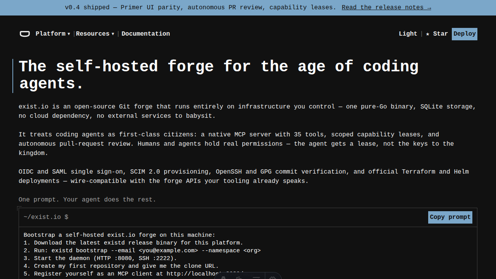

<div align="center">



<p align="center">
  <strong>Self-hosted Git forge built for coding agents</strong>
</p>

<p align="center">
  <a href="https://github.com/RavaniRoshan/exist.io/actions/workflows/ci.yml"></a>
  <a href="https://ravaniroshan.github.io/exist.io/"></a>
  <a href="CHANGELOG.md"></a>
  <a href="LICENSE"></a>
  
  
  
</p>

[**Product Documentation**](https://ravaniroshan.github.io/exist.io/) &nbsp;&bull;&nbsp; [**Getting Started**](https://ravaniroshan.github.io/exist.io/getting-started) &nbsp;&bull;&nbsp; [**Architecture**](https://ravaniroshan.github.io/exist.io/architecture) &nbsp;&bull;&nbsp; [**Roadmap**](ROADMAP.md) &nbsp;&bull;&nbsp; [**Claims Ledger**](CLAIMS.md) &nbsp;&bull;&nbsp; [**Contributing**](CONTRIBUTING.md)

</div>

---

**exist.io** is a vendor-neutral, self-hosted Git forge engineered from first principles for **autonomous AI coding agents** (Claude Code, Codex, Cline, Cursor) alongside human engineering teams.

While proprietary platforms tie agent workspaces to closed cloud accounts, exist.io runs entirely on your own server. It ships as a single pure-Go binary with an embedded web UI, pure-Go SSH server on port `2222` (zero host OpenSSH dependency), native Model Context Protocol (MCP) server at `/mcp`, and ephemeral HMAC capability leases with ref isolation.

> *Unlike Cursor Origin, which is tied to Cursor accounts and proprietary infrastructure, exist.io is 100% vendor-neutral and self-hosted on your own hardware for any agent.*

---

## ⚡ 90-Second Agent Loop Demo

<!-- DEMO_GIF_PLACEHOLDER: A 90-second scriptable terminal recording showing agent lease issue -> git push -> pull request -> review comment -> policy merge -> lease revocation -->
<p align="center">
  
</p>

---

## 🚀 5-Minute Quickstart

`existd` is a single hermetic binary with the full web UI embedded. One command to build, one command to bootstrap, and your forge is live.

### 1. Build from Source

```bash
# Build the forge daemon (single binary with embedded Web UI, zero cgo)
go build -o bin/existd ./cmd/existd

# Build the companion CLI
go build -o bin/exist ./cmd/exist
```

### 2. Bootstrap Your Forge Administrator

Initialize the SQLite WAL database, create the initial organization namespace, and issue your administrator token:

```bash
./bin/existd bootstrap \
  --email admin@corp.exist.io \
  --namespace acme \
  --data-dir ./data
```

### 3. Start the Server

```bash
# Start existd on HTTP :8080 (UI, API, MCP, Git) and SSH :2222
./bin/existd
```

Open **`http://localhost:8080`** in your browser to view the living web dashboard.

---

## 🤖 Connecting AI Coding Agents (MCP)

`exist.io` speaks the standard [Model Context Protocol (MCP)](https://modelcontextprotocol.io) over JSON-RPC 2.0. Add exist.io to your agent configuration (Claude Code, Cursor, Cline):

```json
{
  "mcpServers": {
    "exist-io": {
      "url": "http://localhost:8080/mcp",
      "headers": {
        "Authorization": "Bearer <your-admin-token>"
      }
    }
  }
}
```

> [!TIP]
> **Read-Only Sandbox:** For low-privilege agent exploration, point your agent to `http://localhost:8080/mcp/readonly`. All mutation attempts (`create_pull_request`, `merge_pull_request`, review comments) are rejected at the protocol layer.

### Core MCP Tool Set

| Tool Name | Type | Description |
| :--- | :--- | :--- |
| `get_git_tree` | Read | Recursively inspect file trees at any commit SHA or branch ref |
| `get_file_contents` | Read | Read blob contents, encoding, and metadata |
| `compare_commits` | Read | Calculate two-way and three-way diffs between branches or commits |
| `search_symbols` | Read | AST symbol search across Go, TypeScript/JavaScript, and Python |
| `create_pull_request` | Write | Open a pull request with base and head branch specifications |
| `create_pull_request_comment` | Write | Post review comments on pull request threads |
| `checks_read` | Read | Inspect check run conclusions and required policy gates |
| `merge_pull_request` | Write | Execute a 3-way or squash merge through branch protection checks |

---

## 📊 Verified Comparison Matrix

Only verifiable technical facts are reported below:

| Feature / Dimension | **exist.io** | **Cursor Origin** | **GitHub (Enterprise)** | **Forgejo / Gitea** |
| :--- | :--- | :--- | :--- | :--- |
| **Self-Hosted** | **Yes** (single binary) | No (cloud only) | Server edition only | **Yes** |
| **Vendor Neutrality** | **Any agent** (Claude, Codex, Cline, Cursor) | Cursor-only accounts | Any | Any |
| **MCP Native Server** | **Built-in** (`/mcp` + `/mcp/readonly`) | Proprietary API | Via external wrappers | Via community plugins |
| **Agent Leases (`refs/heads/agent/*`)** | **Built-in HMAC leases** | Proprietary | Fine-grained PATs | Branch protection only |
| **Pure-Go SSH Server** | **Yes** (:2222, zero OpenSSH dependency) | N/A | Host OpenSSH daemon | Host OpenSSH / Go SSH |
| **Zero CGO Compilation** | **Yes** (`modernc.org/sqlite`) | N/A | Closed-source | Requires CGO or SQLite build tags |
| **Database Architecture** | **SQLite WAL** (zero external DB) | Proprietary cloud DB | MySQL / Cloud SQL | SQLite / Postgres / MySQL |
| **Commit Signatures** | **OpenSSH SIGSPEC & GPG** | Proprietary | GPG, SSH, S/MIME | GPG, SSH |

---

## ⚙️ Honest Architectural Limits & Scope

To ensure realistic expectations, exist.io documents its design constraints explicitly:

1. **SQLite WAL Concurrency (Single-Writer)**:
   exist.io uses pure-Go SQLite in Write-Ahead Logging (WAL) mode. Reads scale concurrently across goroutines, but write transactions (`git push`, PR creation, comments) are executed with a serialized database lock. exist.io is optimized for small to medium teams (1–25 concurrent agents and engineers), not hyper-scale thousands-of-pushes-per-second workloads.
2. **go-git Performance Profile**:
   Bare repository operations use `go-git/v6` directly in Go memory. While completely hermetic and CGO-free, `go-git` exhibits higher memory consumption and slower packfile generation on massive monorepos (> 2 GB) compared to native C git.
3. **No Automated Merge Queue in v0.5.0-beta**:
   PR merges are executed synchronously with deterministic 3-way and squash merge engines. Asynchronous merge queues with speculative batching are deferred to the post-launch roadmap.

---

## 🌐 Service Endpoints

`existd` serves all forge transports and APIs on documented, isolated endpoints:

| Endpoint | Protocol | Description |
| :--- | :--- | :--- |
| `http://localhost:8080/` | Web UI | Embedded living developer dashboard & administration |
| `http://localhost:8080/{owner}/{repo}.git` | Git Smart-HTTP | Pure-Go authenticated clone, fetch, and push |
| `ssh://git@localhost:2222/{owner}/{repo}.git` | Pure-Go SSH | Embedded SSH clone, fetch, and push (:2222) |
| `http://localhost:8080/mcp` | MCP JSON-RPC | Read-write Model Context Protocol endpoint |
| `http://localhost:8080/mcp/readonly` | MCP JSON-RPC | Sandboxed read-only Model Context Protocol endpoint |
| `http://localhost:8080/api/v1/*` | REST API | Core forge REST operations |
| `http://localhost:8080/healthz` | HTTP | Liveness probe endpoint |
| `http://localhost:8080/metrics` | Prometheus | Prometheus cluster metrics exposition |

---

## 🧪 Experimental Modules (Scope Freeze)

The following modules build cleanly and pass automated unit tests, but are frozen for the v0.5.0-beta release while focus is locked on the core agent loop:

- **Git LFS File Locking (`/info/lfs/locks`)**: Implemented in `internal/gitlfs`, frozen.
- **Enterprise Federation (SCIM 2.0 & OIDC/SAML)**: Implemented in `internal/auth`, frozen for external security review.
- **Infrastructure as Code**: Terraform provider (`deploy/terraform-provider-exist`) and Helm chart (`deploy/helm/exist-enterprise`), frozen.
- **Enterprise Multi-Service Compose**: `docker-compose.enterprise.yml` with MinIO and Litestream, frozen.

---

## 🧪 Verification & Automated Testing

Every pull request and release is validated by automated CI:

```bash
# Run all Go tests with race detection
go test -v -race ./...

# Run frontend Vitest automated test suite (37 suites, 137 tests)
cd web && npm test

# Verify production frontend build
cd web && npm run build

# Validate documentation site
cd site && npm run validate && npm run build
```

---

## 📄 License & Governance

- **Code License**: Licensed under the [Apache License, Version 2.0](LICENSE).
- **Trademarks**: Name and branding guidelines are governed by [TRADEMARK.md](TRADEMARK.md).
- **Security**: Vulnerability reporting policy is available at [SECURITY.md](SECURITY.md).
- **Contributing**: Development runbook and guidelines are in [CONTRIBUTING.md](CONTRIBUTING.md).
- **Code of Conduct**: Community pledge is located at [CODE_OF_CONDUCT.md](CODE_OF_CONDUCT.md).
