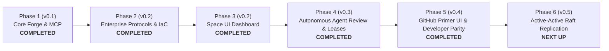

# exist.io Product Roadmap

  <strong>A forward-looking architectural and feature roadmap for the open-source exist.io forge.</strong>

---

## Vision & Philosophy

**exist.io** is designed to be the definitive open-source, self-hosted Git forge built from the ground up for both **human engineering teams** and **autonomous AI coding agents**.

Traditional Git forges were created 15+ years ago for humans clicking in web browsers. exist.io bridges this generational gap: providing dual Git transports (Smart-HTTP + embedded pure-Go SSH :2222), Git LFS v1 CAS storage, cryptographic commit signature verification, first-class Model Context Protocol (MCP) agent connectivity, deterministic 3-way merge policies, enterprise identity federation (OIDC/SAML/SCIM 2.0), and official Infrastructure as Code (Terraform & Helm)—all running hermetically on infrastructure you control.

This document outlines the evolutionary phases of the project, from current foundational milestones to upcoming capabilities.

---

## Milestone Overview

---

## Phase 1: Core Protocol & Forge Foundation (v0.1.0) — COMPLETED

- [x] **Smart-HTTP Git Engine:** Pure-Go HTTP Git transport supporting authenticated `git clone`, `git fetch`, and `git push`.
- [x] **100% Wire API Parity:** All 119 Origin REST API operations implemented across namespaces, repositories, branches, commits, trees, blobs, diffs, pull requests, reviews, checks, and rulesets.
- [x] **Model Context Protocol (MCP) Server:** Built-in JSON-RPC 2.0 server at `/mcp` (34 tools) and `/mcp/readonly` sandbox for AI coding agents.
- [x] **3-Way Merge & Ruleset Engine:** Native 3-way merge, squash merge, conflict detection, required review gates, and passing check enforcement.
- [x] **Enterprise Security & Policy:** Branch/tag rulesets, bypass actor hierarchies, inbound IP allowlists (CIDR filtering), and SSH Certificate Authorities.
- [x] **Companion CLI:** `exist` command-line utility in `cmd/exist` for managing repos, PRs, apps, and credentials.
- [x] **Hermetic Storage:** Pure-Go SQLite in WAL mode (`modernc.org/sqlite`, zero cgo) paired with `go-git/v6` bare repository storage.

---

## Phase 2: Enterprise Transports, Protocols & IaC (v0.2.0) — COMPLETED

- [x] **Embedded Pure-Go SSH Server (:2222):** Zero-cgo standalone SSH daemon for `git clone` and `git push` without requiring host OpenSSH daemons.
- [x] **Git LFS v1 Batch & CAS Engine:** Content-Addressable Storage (CAS) with SHA-256 validation, streaming chunked upload/download, and binary file locking protocol (`/info/lfs/locks`).
- [x] **Cryptographic Commit Verification:** Real-time OpenSSH SIGSPEC and GPG (RFC 4880) signature parsing with public key fingerprint matching.
- [x] **Enterprise Identity Federation & SCIM 2.0:** RFC 7644 SCIM user sync at `/scim/v2/Users` with automated provisioning and immediate offboarding revocation; OIDC & SAML 2.0 Single Sign-On.
- [x] **Official Terraform / OpenTofu Provider:** Dedicated provider in `deploy/terraform-provider-exist` managing namespaces, repos, rulesets, CIDR allowlists, and SSH CAs.
- [x] **Production Kubernetes Helm Chart:** Complete chart in `deploy/helm/exist-enterprise` with dual-port service (HTTP 8080, SSH 2222), PVC storage, Prometheus ServiceMonitor, and non-root security contexts.

---

## Phase 3: Space UI Living Dashboard & Environment Separation (v0.2.0) — COMPLETED

- [x] **Production vs. Sandbox Separation:** Strict isolation between live production backend and isolated mock fixtures in `mockData.ts`.
- [x] **Authentic Empty States:** Purposeful empty states with direct 1-click calls to action across code, commits, rulesets, webhooks, and users.
- [x] **Commit Signature Inspection Drawer:** Interactive popover displaying cryptographic verification status, key type, fingerprint, and signer email.
- [x] **Ruleset Merge Gates & CIDR Allowlist UI:** Interactive branch protection editor and corporate IP allowlist manager.
- [x] **Webhook Delivery Audit Log:** Dispatched JSON payload inspector with HMAC-SHA256 verification, test ping trigger, and batch redeliver.
- [x] **Operator Telemetry Dashboard:** Real-time metrics for Pure-Go SSH, Git LFS CAS, SQLite WAL sync, MCP 34 tools, and Prometheus exposition.

---

## Phase 4: Autonomous Agent Execution & Review Sandbox (v0.3.0) — COMPLETED

Taking agent integration beyond passive MCP queries to active, forge-native autonomous workflows:

- [x] **Automated PR Review Agent (`internal/agentreviewer`):** Configurable reviewer that inspects diffs, detects leaked cryptographic keys/tokens, evaluates unit test coverage, outputs rich Markdown diagnostics, and reports check runs.
- [x] **Ephemeral Agent Capability Leases (`pkg/agentlease`):** Short-lived, HMAC-SHA256 cryptographically signed capability tokens issued to autonomous agents with ref-prefix isolation (`refs/heads/agent/*`) and automatic expiration.
- [x] **Pure-Go Semantic AST Symbol Search (`internal/symbolsearch`):** High-speed code symbol indexing across Go AST, TypeScript/JavaScript, and Python files; exposed via REST API and MCP tool `search_symbols`.
- [x] **Agent Activity Telemetry Stream (`internal/agentactivity`):** Thread-safe bounded memory ring buffer streaming autonomous agent tool invocations and PR reviews to `GET /api/v1/agent/activities`.
- [x] **Craft-First Space UI Integration:** Live PR review trigger action, merge execution, semantic symbol search popover, and capability lease issuance drawer.

---

## Phase 5: GitHub Primer UI & Developer Parity (v0.4.0) — COMPLETED

Achieving pixel-accurate developer ergonomics and end-user workflow parity with GitHub Enterprise:

- [x] **Strict GitHub Primer Design System:** Canonical 6px squircle radius, 1px crisp borders, UnderlineNav tabs with aria attributes, flush Box rows, and custom OKLCH color token architecture.
- [x] **User Profile Page (`UserProfileView`):** Developer identity card, company/location/timezone metadata, organizations list, 52-week contribution activity calendar heatmap, filterable repository catalog, SSH key management with validation, and Personal Access Tokens (PATs) with scope selection.
- [x] **Global Enterprise Activity Feed (`GlobalHomeView`):** Organization-wide activity feed displaying autonomous agent merges, releases, commits, and PRs, paired with cluster telemetry metrics.
- [x] **Enterprise Issues System (`IssuesView`):** Open/closed issue catalog, label taxonomy, comment thread with markdown support, and 1-click autonomous triage delegation to Exist Agent.
- [x] **Releases & Tags Distribution (`ReleasesView`):** Tagged binary distribution, cryptographic checksum validation, downloadable source code archives, and draft release publishing.
- [x] **Enterprise Administration Suites:** Dedicated cluster health telemetry inspector, SSO configuration form, enterprise user seat management, and audit log compliance query engine.
- [x] **Zero-Mock Production & Interactive User Guide:** Live Git and SQLite WAL aggregation with authentic GitHub Primer empty states, interactive 5-step onboarding walkthrough (`ProductTour`), and comprehensive architectural manual (`UserManualModal`).
- [x] **100% Comprehensive Unit Test Coverage:** 100 automated unit tests across 28 suites in Vitest with zero failures and verified production bundle build.

---

## Phase 6: High Availability & Active-Active Consensus (v0.5.0+)

Scaling exist.io for massive enterprise footprints:

- [ ] **Multi-Region Active-Active Raft Replication:** Raft-coordinated metadata consensus across geographically distributed nodes.
- [ ] **Distributed Git Object Sharding:** Automated packfile sharding across MinIO / S3 buckets with local read caches.
- [ ] **Disaster Recovery Failover Controller:** Zero-downtime automated failover with continuous Litestream S3 sync.
