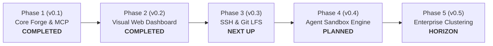

# exist.io Product Roadmap

  <strong>A forward-looking architectural and feature roadmap for the open-source exist.io forge.</strong>

---

## Vision & Philosophy

**exist.io** is designed to be the definitive open-source, self-hosted Git forge built from the ground up for both **human engineering teams** and **autonomous AI coding agents**.

Traditional Git forges were created 15+ years ago for humans clicking in web browsers. exist.io bridges this generational gap: providing full Git Smart-HTTP compatibility, first-class Model Context Protocol (MCP) agent connectivity, deterministic 3-way merge policies, and enterprise-grade security—all running hermetically on infrastructure you control.

This document outlines the evolutionary phases of the project, from current foundational milestones to upcoming capabilities.

---

## Milestone Overview

---

## Phase 1: Core Protocol & Forge Foundation (v0.1.0) — COMPLETED

- [x] **Smart-HTTP Git Engine:** Pure-Go HTTP Git transport supporting authenticated `git clone`, `git fetch`, and `git push`.
- [x] **100% Wire API Parity:** All 119 Origin REST API operations implemented across namespaces, repositories, branches, commits, trees, blobs, diffs, pull requests, reviews, checks, and rulesets.
- [x] **Model Context Protocol (MCP) Server:** Built-in JSON-RPC 2.0 server at `/mcp` (34 tools) and `/mcp/readonly` sandbox for AI coding agents.
- [x] **3-Way Merge & Ruleset Engine:** Native 3-way merge, squash merge, conflict detection, required review gates, and passing check enforcement.
- [x] **Enterprise Security & Policy:** Branch/tag rulesets, bypass actor hierarchies, inbound IP allowlists (CIDR filtering), and SSH Certificate Authorities.
- [x] **Companion CLI:** `exist` command-line utility in `cmd/exist` for managing repos, PRs, apps, and credentials.
- [x] **Hermetic Storage:** Pure-Go SQLite in WAL mode (`modernc.org/sqlite`, zero cgo) paired with `go-git/v6` bare repository storage.
- [x] **Terraform Compatibility:** Verified compatibility with Terraform provider client patterns.

---

## Phase 2: Visual Web Dashboard & Human Experience (v0.2.0) — COMPLETED

While coding agents communicate over MCP and automation tools use the CLI, human engineers need an intuitive, responsive web interface. Phase 2 delivers a modern web dashboard built with Space UI living sensory components, Tailwind CSS v4, and Motion.

### 1. Repository Explorer
- [x] **Interactive Tree Navigation:** File tree browser with branch/tag switcher and breadcrumbs.
- [x] **Syntax Highlighting & Markdown Viewer:** Fast client-side rendering for source code, READMEs, and documentation.
- [x] **Commit History & Blame:** Visual commit log with author avatars, diff hashes, and verified commit badges.

### 2. Pull Request & Diff Reviewer
- [x] **Side-by-Side & Unified Diffs:** High-performance diff viewer with additions/deletions highlighting and hunk headers.
- [x] **Inline Code Review Threads:** Comment threads supporting both human developers and autonomous AI agents.
- [x] **Interactive Merge Gate:** Clear visual indicators for required reviews, passing/failing status checks, and merge queue status.
- [x] **Space UI Slide-to-Confirm:** Sensory drag-to-confirm merge button with celebratory confetti trigger.

### 3. AI Agent Telemetry & MCP Engine
- [x] **Live MCP Telemetry:** Real-time monitoring of all 34 tools mounted on `/mcp`.
- [x] **Interactive Tool Runner:** In-browser JSON-RPC tool caller with latency counter and response inspection.
- [x] **Real-time Agent Activity Feed:** Audit log of autonomous agent tool calls (Claude Code, Cursor, Codex).

### 4. Policy, Security & Webhook Inspector
- [x] **Ruleset Gates:** Visual branch protection editor (require approvals, passing checks, block force pushes).
- [x] **Inbound CIDR Allowlists:** Interactive IP allowlist manager for corporate subnets.
- [x] **SSH Certificate Authorities:** Visual inspector for trusted SSH CAs and ephemeral user keys.
- [x] **Webhook Delivery Log:** Dispatched webhook event stream with HTTP status codes, latency, and manual redelivery.

---

## Phase 3: Native SSH Transport & Git LFS (v0.3.0)

Expanding network transport and file handling capabilities for enterprise developers:

- [ ] **Embedded Pure-Go SSH Server:** Built-in SSH server (running on port 22 or configurable port 2222) allowing developers to clone and push via `git@host:namespace/repo.git` using standard SSH keys without needing system-level user accounts.
- [ ] **Git Large File Storage (Git LFS):** Native implementation of the Git LFS batch API, storing large binary assets (datasets, model checkpoints, media) either on local disk or S3-compatible object stores (MinIO, AWS S3, Cloudflare R2).
- [ ] **GPG & SSH Commit Verification:** Automatic cryptographic verification of signed git commits and tags, displaying a "Verified" badge in the UI and enforcing commit signature rulesets.
- [ ] **On-the-Fly Archive Streaming:** Live generation and streaming of `.tar.gz` and `.zip` source snapshots for any commit, tag, or branch.

---

## Phase 4: Autonomous Agent Execution Sandbox (v0.4.0)

Taking agent integration beyond passive MCP queries to active, forge-native autonomous workflows:

- [ ] **Forge-Native Task Dispatcher:** Capability for `existd` to trigger containerized agent workers (Docker, Wasm, or microVMs) in response to repository events (e.g. issues labeled `agent-fix`, pull request review requests).
- [ ] **Automated PR Review Agent:** Configurable agent hook that automatically reads PR diffs, executes linters, tests against local sandboxes, and posts line-level review suggestions.
- [ ] **Ephemeral Agent Leases:** Short-lived, cryptographic capability tokens issued to autonomous agents that expire automatically after a task completes, strictly bound to specific branch namespaces.
- [ ] **Agent Work Log & Audit Trail:** Full recording of agent tool invocations, prompts, and execution steps linked directly to pull request review threads.

---

## Phase 5: High Availability & Enterprise Federation (v0.5.0+)

Scaling exist.io for high-throughput enterprise deployments:

- [ ] **Database Replication:** Continuous, zero-downtime SQLite WAL replication using Litestream or Raft-based consensus, with optional PostgreSQL storage backend driver for ultra-high-volume clusters.
- [ ] **Distributed Git Storage:** Multi-node repository replication with read-replica routing and automated failover.
- [ ] **Cross-Forge Federation:** Bi-directional synchronization and automated mirroring between distinct exist.io instances and external Git forges.
- [ ] **OpenID Connect (OIDC) & SAML 2.0:** Single Sign-On (SSO) integration for Okta, Keycloak, GitHub, and Google Workspace.

---

## Contributing to the Roadmap

We welcome input, RFCs, and contributions from both human developers and agent system builders. 

- **Discussion & Feature Requests:** Open an issue on GitHub to discuss design proposals.
- **Implementation:** Check the [Getting Started guide](https://ravaniroshan.github.io/exist.io/getting-started) to set up your local development environment and run tests.
