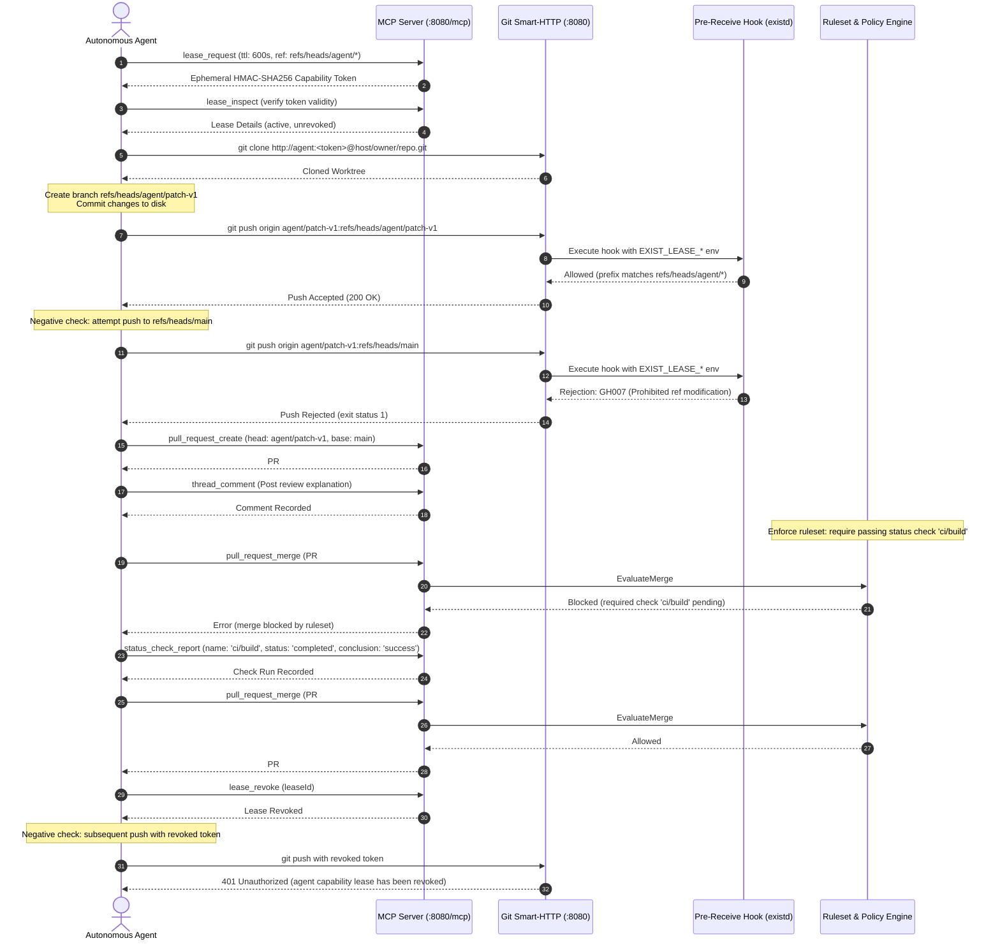

# Testing Strategy & Mutation Checks (`docs/testing.md`)

This document outlines the testing architecture, validation invariants, and mutation verification protocols for **exist.io**.

---

## 1. Automated Test Hierarchy

| Layer | Packages | Runner | Purpose |
| :--- | :--- | :--- | :--- |
| **Unit Tests** | `internal/store`, `internal/security`, `pkg/agentlease`, `internal/auth` | `go test -race` | Verifies low-level algorithms, SQL queries, crypto signatures, secret scanning, and lease token parsing. |
| **Protocol & API Tests** | `internal/mcp`, `internal/gittransport`, `internal/origin` | `go test -race` | Validates JSON-RPC 2.0 MCP tools, Smart-HTTP clone/push transport, and REST API handlers. |
| **End-to-End Integration** | `internal/app/agent_loop_e2e_test.go` | `go test -v -run TestAgentLoop_EndToEnd_RealServer` | Validates full real-world agent workflow on a live HTTP daemon using native git CLI with zero mocks. |
| **Frontend UI Tests** | `web/src/**/__tests__/*.test.tsx` | `vitest run` | 37 test suites verifying Primer components, repository views, settings modals, and demo-mode gating. |

---

## 2. End-to-End Agent Loop Verification (`TestAgentLoop_EndToEnd_RealServer`)

The canonical autonomous agent workflow is executed without any mocks against a running `existd` instance:



---

## 3. Mutation Checks (Anti-False-Positive Verification)

Per Project Rule 2 (*No false positives*), every security gate and policy check must be validated with deliberate mutation testing.

### Mutation 1: Capability Lease Ref Prefix Gate
- **Target**: `pkg/agentlease/lease.go` (`CanPushRef`)
- **Mutation**: Force `CanPushRef` to return `true` unconditionally.
- **Expected Failure**: `go test ./pkg/agentlease` fails with:
  ```text
  lease_test.go:44: expected rejection for refs/heads/main, got true
  lease_test.go:47: expected rejection for refs/heads/master, got true
  lease_test.go:50: expected rejection for random branch outside allowed prefix, got true
  ```
- **Observed Result**: Test failed as expected. Code restored, test returned to 100% pass.

### Mutation 2: MCP Merge Policy Evaluation Gate
- **Target**: `internal/mcp/tools.go` (`pull_request_merge` handler)
- **Mutation**: Bypass ruleset blocker evaluation `if false && !evalRes.Allowed`.
- **Expected Failure**: `go test -run TestMCP_CanonicalAgentLoopTools ./internal/mcp` fails with:
  ```text
  server_test.go:535: expected pull_request_merge to be blocked by missing check run, but it succeeded: isError:false
  ```
- **Observed Result**: Test failed as expected. Code restored, test returned to 100% pass.

### Mutation 3: Pre-Receive Hook Default Branch Protection
- **Target**: `internal/security/hook.go` (Agent capability lease ref prefix check)
- **Mutation**: Invert `permitted = false` default to `permitted = true`.
- **Expected Failure**: `go test -run TestPreReceiveHook_AgentLeaseEnforcement ./internal/security` fails on unauthorized branch push.
- **Observed Result**: Test failed as expected. Code restored, test returned to 100% pass.

---

## 4. Running the Complete Verification Suite

```bash
# 1. Run all Go tests with race detection
export PATH="/home/linuxbrew/.linuxbrew/bin:$PATH"
go test -race ./...

# 2. Run end-to-end agent loop integration test
go test -v -run TestAgentLoop_EndToEnd_RealServer ./internal/app

# 3. Run frontend Vitest test suite
cd web
npm test
npm run build
```
