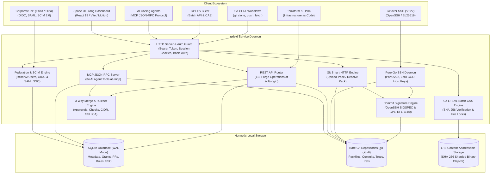

exist.io is designed as a single, self-contained Go binary with clear separation of responsibilities between forge metadata, Git object storage, and protocol transport.

## System overview

## Storage model

exist.io separates data storage into three specialized layers:

### 1. Forge metadata (SQLite WAL)

All non-Git entities are managed by a SQLite database running in Write-Ahead Logging (WAL) mode with foreign key constraints enforced:

- **Identity & Credentials:** Users, password hashes (bcrypt), active web sessions, API tokens (stored as SHA-256 hashes), user SSH public keys, and Personal Access Tokens.
- **Grants & Authorization:** Namespace and repository role assignments (`admin`, `write`, `read`).
- **Pull Requests & Social:** PR metadata, review threads, line-level comments, reactions, and labels.
- **Checks & Rulesets:** Check suites, check runs, branch/tag protection rulesets, and bypass actor lists.
- **Enterprise Controls:** Inbound IP allowlists (CIDR blocks), SSH Certificate Authorities, and SSO / SCIM configurations.

The database runs via `modernc.org/sqlite`, a pure Go implementation requiring zero cgo compilers.

### 2. Git object storage (`go-git`)

Repository source code is stored as bare Git repositories managed by `github.com/go-git/go-git/v6` under the operator's configured data directory (`./data/repos/{owner}/{repo}.git`):

- Standard Git packfiles, trees, commits, blobs, and references.
- Repositories are standard Git directories that can be backed up or transferred with standard tools.

### 3. Git LFS Content-Addressable Storage (CAS)

Large binary assets are stored in a Content-Addressable Storage directory (`./data/lfs/objects/{oid[0:2]}/{oid[2:4]}/{oid}`) verified with cryptographic SHA-256 hashes.

---

## Protocol engines

### Embedded Pure-Go SSH Server

Runs on port `2222` (configurable via `EXIST_SSH_ADDR`):
- Pure Go SSH implementation with zero host OpenSSH daemon requirements.
- Authenticates Git clients against user public keys in the SQLite database and organization-wide SSH Certificate Authorities.
- Supports streaming `git-upload-pack` and `git-receive-pack` with pre-receive security push protection hooks.

### Git Large File Storage (LFS) v1 Engine

Mounted under repository endpoints:
- Implements the Git LFS v1 Batch HTTP protocol (`/info/lfs/objects/batch`).
- Streaming binary object upload with real-time SHA-256 checksum verification.
- Streaming object downloads with HTTP `Range` headers.
- RFC-compliant binary file locking protocol (`/info/lfs/locks`) preventing merge collisions on unmergeable assets.

### Cryptographic Commit Signature Engine

- Parses **OpenSSH SIGSPEC** binary signatures and **GPG (OpenPGP RFC 4880)** ASCII armor.
- Evaluates committer public key fingerprints against enrolled developer keys.
- Surfaces cryptographic verification audit data in the Web UI and REST API.

### Enterprise Federation & SCIM 2.0 Engine

- Implements **RFC 7643 / RFC 7644 SCIM 2.0** at `/scim/v2/Users` for automated user provisioning and offboarding.
- Single Sign-On (SSO) support for both **OpenID Connect (OIDC)** and **SAML 2.0**.
- Automatic workspace provisioning upon first login and session cookie lifecycle management.

### Model Context Protocol (MCP) server

Mounted at `/mcp` (read-write) and `/mcp/readonly`:
- Implements JSON-RPC 2.0 per the Model Context Protocol specification.
- Exposes **34 specialized tools** enabling AI coding agents to navigate codebases, inspect diffs, open pull requests, post review comments, and report status check results.

### Merge and ruleset policy engine

- Native 3-way merge and squash merge logic.
- Evaluates branch and tag rulesets before push and merge operations.
- Enforces required review approvals, unresolved review thread blockers, and passing status checks.
- Honors bypass actor configurations for designated administrators.
