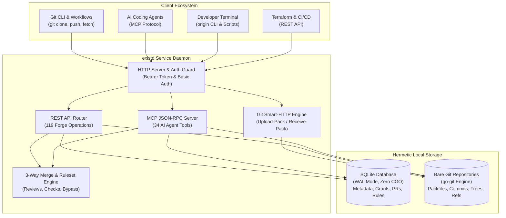

exist.io is designed as a single, self-contained Go binary with clear separation of responsibilities between forge metadata, Git object storage, and protocol transport.

## System overview

## Storage model

exist.io separates data storage into two specialized layers:

### 1. Forge metadata (SQLite)

All non-Git entities are managed by a SQLite database running in Write-Ahead Logging (WAL) mode with foreign key constraints enforced:

- **Identity & Credentials:** Users, namespaces, API tokens (stored as SHA-256 hashes), passwords, and SSH keys.
- **Grants & Authorization:** Namespace and repository role assignments (`admin`, `write`, `read`).
- **Pull Requests & Social:** PR metadata, review threads, line-level comments, reactions, and labels.
- **Checks & Rulesets:** Check suites, check runs, branch/tag protection rulesets, and bypass actor lists.
- **Enterprise Controls:** Inbound IP allowlists (CIDR blocks), SSH Certificate Authorities, GitHub mirror configurations, and webhook deliveries.

The database runs via `modernc.org/sqlite`, a pure Go implementation requiring zero cgo compilers.

### 2. Git object storage (`go-git`)

Repository source code is stored as bare Git repositories managed by `github.com/go-git/go-git/v6` under the operator's configured data directory (`./data/repos/{owner}/{repo}.git`):

- Standard Git packfiles, trees, commits, blobs, and references.
- No proprietary formats: repositories are standard Git directories that can be backed up or transferred with standard tools.

## Protocol engines

### Git Smart-HTTP engine

Mounted at `http://<host>/{owner}/{repo}.git`:
- Implements standard Git HTTP transfer protocols (`git-upload-pack` and `git-receive-pack`).
- Fully supports `git clone`, `git fetch`, and `git push`.
- Enforces repository permissions before opening pack streams.

### Model Context Protocol (MCP) server

Mounted at `/mcp` (read-write) and `/mcp/readonly`:
- Implements JSON-RPC 2.0 per the Model Context Protocol specification.
- Exposes **34 specialized tools** enabling AI coding agents to navigate codebases, inspect diffs, open pull requests, post review comments, and report status check results.
- The `/mcp/readonly` mount acts as a capability sandbox, rejecting mutation attempts at the protocol boundary.

### REST API engine

Mounted at `/v1/origin`:
- 100% wire coverage of the 119 Origin operations.
- Uniform error envelopes and monotonic ULID identifiers.
- Dynamically publishes the OpenAPI 3.1 specification at `/v1/origin/openapi.yaml`.

### Merge and ruleset policy engine

- Native 3-way merge and squash merge logic.
- Evaluates branch and tag rulesets before push and merge operations.
- Enforces required review approvals, unresolved review thread blockers, and passing status checks.
- Honors bypass actor configurations for designated administrators.

## Security & trust boundaries

- **Hashed Secrets:** Bearer tokens and passwords are never stored in plaintext; all secrets are salted and hashed with SHA-256 / bcrypt before database insertion.
- **IP Allowlists:** Inbound requests can be restricted to verified CIDR ranges per namespace or repository.
- **SSH Certificate Authorities:** Operators can configure trusted SSH CAs for signature verification.
- **Webhook Integrity:** Outbound webhook payloads are signed with Ed25519 signatures, allowing receivers to cryptographically verify payload origin.
