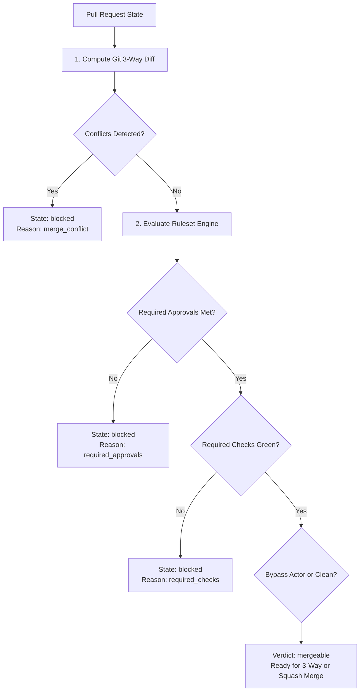

In an agent-native forge, pull requests are frequently created and merged by autonomous software agents. To protect codebase integrity, exist.io pairs a native Git 3-way merge engine with a deterministic ruleset evaluator.

## The Merge Lifecycle

When a pull request is created or updated, exist.io evaluates whether the pull request is clean, has merge conflicts, or is blocked by policy rulesets:

## 1. Git 3-Way Merge Computation

The merge engine computes the lowest common ancestor (merge base) between the target branch (e.g. `main`) and the head branch (e.g. `feature/x`):

1. **Merge Base Resolution:** Resolves commit hashes for `base` and `head` via `go-git`, then traces parent commit graphs to locate their common ancestor commit.
2. **Tree Diffing:** Compares the merge base tree against both head and base trees to detect overlapping file modifications.
3. **Conflict Detection:** If the same byte offset or hunk within a file has diverged in both branches without an unambiguous automatic resolution, the engine marks the PR with `mergeable: false` and sets the blocker kind to `conflict`.

## 2. Ruleset Engine Evaluation

If the Git tree diff is conflict-free, the request is evaluated against all active rulesets applicable to the target branch.

Rulesets can enforce three levels of gating:

### A. Required Approvals Gate
- Pull requests can require $N$ approving review submissions from repository collaborators.
- If unaddressed review threads exist that are marked as unresolved, the merge engine treats them as an active blocker until the author or reviewer marks them resolved.

### B. Required Status Checks Gate
- Any CI runner, static analysis tool, or agent test suite can register `CheckSuite` and `CheckRun` records on the commit SHA.
- The ruleset defines which check contexts (e.g., `ci/tests`, `lint/vet`) must report a conclusion of `success`.
- If any required check is `pending`, `failure`, or missing, the PR is held in a blocked state.

### C. Bypass Actor Hierarchy
- Certain automated deployment bots or system administrators may hold `bypass_actors` permissions.
- When an actor with `bypass_mode: "always"` requests a merge, the engine bypasses approval and check restrictions while still requiring a conflict-free Git merge.

## 3. Merge Strategies

When a pull request is merged, callers can choose between two strategies:

1. **3-Way Merge (`method: "merge"`):**
   Creates a new merge commit containing two parents (base head and branch head), preserving the full commit history of the feature branch.
2. **Squash Merge (`method: "squash"`):**
   Condenses all commits in the feature branch into a single commit applied on top of the base branch, producing a clean, linear git history.
